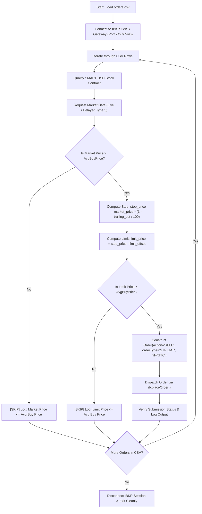

# 📉 IBKR Automated Trailing Stop-Limit Execution Engine

[](https://python.org)
[](https://interactivebrokers.com)
[](https://github.com/erdewit/ib_insync)
[](https://opensource.org/licenses/MIT)

> An algorithmic execution script for **Interactive Brokers (IBKR)** built with Python and `ib_insync`. Automatically parses equity target portfolios from a CSV manifest, fetches real-time/delayed market quotes, calculates dynamic trailing stop triggers and limit offsets, and dispatches **Good-Till-Canceled (GTC) STP LMT** sell orders with built-in breakeven capital preservation guards.

---

### 💼 Need Custom IBKR Algorithms, Execution Engines, or Automated Trading Bots?
I engineer low-latency trading software, custom broker API connectors, risk-management systems, and institutional quantitative algorithms.
* 💬 **Telegram:** [@JanzebBlockdev](https://t.me/JanzebBlockdev)
* 💼 **Fiverr Profile:** [Verified Quantitative Developer (Fiverr)](https://tinyurl.com/2wruxnsx)
* 📧 **Email:** `jahanzaibchanna70@gmail.com`

---

## 📑 Table of Contents
1. [Key Architectural Highlights](#-key-architectural-highlights)
2. [Execution Logic & Decision Workflow](#-execution-logic--decision-workflow)
3. [Prerequisites & TWS / Gateway Configuration](#-prerequisites--tws--gateway-configuration)
4. [Installation & Setup](#-installation--setup)
5. [CSV Schema & Configuration](#-csv-schema--configuration)
6. [Execution Command](#-execution-command)
7. [Explore Other Quantitative Projects](#-explore-other-quantitative-projects)
8. [Disclaimer](#-disclaimer)

---

## 🚀 Key Architectural Highlights

* **Automated Batch Processing:** Ingests portfolio positions from CSV and iterates through contract qualification, quote acquisition, and order placement seamlessly.
* **Capital Protection Guard:** Automatically skips order placement if the prevailing market price or calculated limit price falls below your `AvgBuyPrice`, preventing unintended realized losses.
* **Adaptive Market Data Fallback:** Automatically requests delayed market data (Type 3) if live real-time market data subscriptions are not active on the account.
* **GTC Time-In-Force:** Dispatches Good-Till-Canceled orders that persist safely across standard market sessions until filled or canceled.
* **Detailed Execution Auditing:** Outputs structured terminal logs detailing every contract qualification, price calculation, and order submission status (`Submitted`, `PreSubmitted`, or `Skipped`).

---

## 🏛️ Execution Logic & Decision Workflow



---

## ⚙️ Prerequisites & TWS / Gateway Configuration

1. **Interactive Brokers TWS or IB Gateway** installed and running.
2. In TWS, navigate to **File $\rightarrow$ Global Configuration $\rightarrow$ API $\rightarrow$ Settings**:
   * Enable ✅ **"Enable ActiveX and Socket Clients"**.
   * Set **Socket Port** to `7497` (Paper Trading) or `7496` (Live Trading).
   * Uncheck ❌ **"Read-Only API"** (to allow order placement).
   * Add `127.0.0.1` to **Trusted IP Addresses**.

---

## 🛠️ Installation & Setup

1. **Clone the repository:**
   ```bash
   git clone https://github.com/jahanzaib-codes/ibkr-trailing-orders.git
   cd ibkr-trailing-orders
   ```

2. **Create a virtual environment & install dependencies:**
   ```bash
   python -m venv .venv
   source .venv/bin/activate  # On Windows: .venv\Scripts\activate
   pip install -r requirements.txt
   ```

---

## 📊 CSV Schema & Configuration

Create or modify `orders.csv` in the root directory:

```csv
Symbol,Quantity,TrailingPercent,LimitOffset,AvgBuyPrice
AAPL,10,1.5,0.30,180.25
TSLA,5,2.0,0.50,700.00
NVDA,15,2.5,0.40,115.00
```

### Parameter Definitions:
| Parameter | Description |
| :--- | :--- |
| `Symbol` | Target equity ticker symbol (e.g., `AAPL`, `MSFT`, `NVDA`). |
| `Quantity` | Total number of shares to place in the sell order. |
| `TrailingPercent` | Percentage below market price where the stop trigger will be set (e.g., `1.5` for 1.5%). |
| `LimitOffset` | Fixed dollar offset subtracted from the stop price to define the limit price. |
| `AvgBuyPrice` | Your breakeven threshold. Script will refuse to place orders below this cost basis. |

---

## ▶️ Execution Command

Ensure IBKR TWS or IB Gateway is logged in and running, then execute:

```bash
python trailing_orders.py
```

---

## ⭐ Explore Other Quantitative Projects

* 🧠 **[Interactive Brokers AI 0DTE Options Bot & GUI](https://github.com/jahanzaib-codes/ibkr-ai-trading-bot-gui)** — Real-time options engine with XGBoost ML, VWAP/RSI/MACD filters, and Tkinter GUI.
* ⚡ **[Solana Pump.fun 0-Block Sniper Bot](https://github.com/jahanzaib-codes/solana-pumpfun-sniper-bot)** — Ultra low-latency meme coin sniper with Jito MEV bundle protection.
* 🛡️ **[PropFirm MT5 Risk Guardian EA](https://github.com/jahanzaib-codes/propfirm-mt5-risk-guardian)** — Institutional MQL5 risk manager enforcing daily & max drawdown limits.
* 🔮 **[Polymarket Prediction Arbitrage Bot](https://github.com/jahanzaib-codes/polymarket-prediction-arbitrage-bot)** — High-speed cross-market binary outcome arbitrage engine.

---

## ⚠️ Disclaimer

*This software is intended for educational, research, and algorithmic demonstration purposes. Algorithmic order execution involves financial risk. Always test scripts thoroughly on an Interactive Brokers Paper Trading account before deploying capital to live production accounts.*

---
*Maintained by **Jahanzaib** ([@jahanzaib-codes](https://github.com/jahanzaib-codes))*
